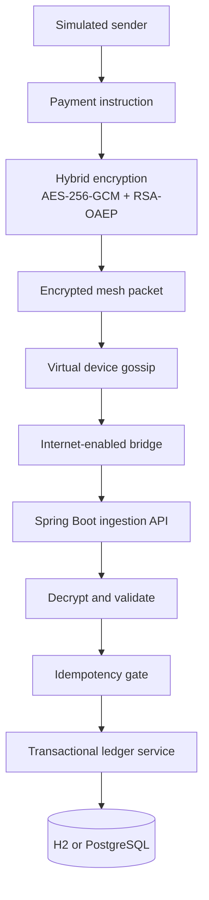

# MeshRelay — Offline Payment Mesh Prototype

**MeshRelay** is a locally runnable Java/Spring Boot prototype that explores how an encrypted payment instruction could be carried across disconnected devices and delivered to a backend when any device regains connectivity.

> **Scope and safety:** MeshRelay is an educational simulator. It is not UPI, does not connect to NPCI or banks, does not move real money, and does not establish that offline payments can be safely settled in production. All accounts and balances are simulated. Never enter a real UPI PIN or real financial data.

## Why this project exists

A conventional payment API generally needs a live connection to payment infrastructure. MeshRelay demonstrates a *store-carry-forward* pattern instead:

1. A simulated sender creates an instruction and encrypts it for the backend.
2. The encrypted packet is injected into a virtual device.
3. The simulator relays packets between virtual devices while reducing their hop TTL.
4. A virtual bridge node that has internet access uploads its packets.
5. The backend authenticates the ciphertext through AES-GCM decryption, checks packet freshness, applies duplicate protection, and records a simulated ledger outcome.



## Project identity and stack

- **Project name:** MeshRelay
- **Artifact:** `meshrelay-offline-payment-prototype`
- **Language/runtime:** Java 17+
- **Backend:** Spring Boot 3.3, Spring MVC, Spring Data JPA, Bean Validation
- **Persistence:** H2 by default; PostgreSQL profile for a more realistic local setup
- **Schema management:** Hibernate automatic schema updates
- **Security primitives in the demo:** RSA-OAEP (SHA-256) to wrap a random AES key, AES-256-GCM for authenticated encryption, SHA-256 ciphertext fingerprint for duplicate detection
- **UI:** Thymeleaf dashboard inherited and enhanced from the starter repository
- **Testing:** JUnit 5, Spring Boot Test
- **Optional runtime:** Docker Compose + PostgreSQL

## Run locally (zero database setup)

Requirements: JDK 17 or newer. The Maven wrapper downloads Maven on first run, so that first run requires internet access.

### Windows PowerShell

```powershell
.\mvnw.cmd spring-boot:run
```

### macOS / Linux

```bash
chmod +x mvnw
./mvnw spring-boot:run
```

Open **http://localhost:8080** for the dashboard. The H2 console is available at **http://localhost:8080/h2-console** for local inspection only. Default connection details:

- JDBC URL: `jdbc:h2:mem:meshrelay;DB_CLOSE_DELAY=-1;DB_CLOSE_ON_EXIT=FALSE`
- User: `sa`
- Password: blank

The demo ensures that five fictional accounts exist (`alice@mesh`, `bob@mesh`, `carol@mesh`, `dave@mesh`, and `erin@mesh`). Missing demo accounts are inserted individually; existing balances are not reset. H2 is in-memory by design in the default profile; data resets when the app restarts.

## Run with PostgreSQL

The PostgreSQL profile is provided for a more production-like local database workflow. Hibernate creates or updates the required tables automatically.

```bash
docker compose up --build
```

Then open **http://localhost:8080**. PostgreSQL data is kept in a named Docker volume. The credentials in `docker-compose.yml` are **local-development-only examples** and must never be reused in a deployed environment.

To run only the application with an existing PostgreSQL instance:

```powershell
$env:SPRING_PROFILES_ACTIVE = "postgres"
$env:DB_URL = "jdbc:postgresql://localhost:5432/meshrelay"
$env:DB_USERNAME = "meshrelay"
$env:DB_PASSWORD = "<your-local-password>"
.\mvnw.cmd spring-boot:run
```

## Tests

```powershell
.\mvnw.cmd test
```

The suite includes concurrent duplicate delivery, competing transfers, insufficient balance, encryption/decryption, tamper detection, five-account/device defaults, and duplicate detection after the in-memory cache is cleared.

### Clean generated files

Maven writes compiled classes, reports, and packaged JAR files to `target/`.
That directory is ignored by Git and can be removed safely when a clean
workspace is needed:

```powershell
Remove-Item -Recurse -Force target
```

The Maven wrapper files under `.mvn/` and the root `mvnw`/`mvnw.cmd` scripts
are required to build the project and should not be removed.

## API quick reference

The API is intentionally open and demo-oriented. **Do not expose it to the public internet.**

| Method | Endpoint | Purpose |
|---|---|---|
| `GET` | `/api/server-key` | Returns the demo server public key and crypto scheme |
| `POST` | `/api/demo/send` | Creates an encrypted demo packet and injects it into the mesh |
| `GET` | `/api/mesh/state` | Lists virtual devices and packet counts |
| `POST` | `/api/mesh/gossip` | Runs one simulated mesh gossip round |
| `POST` | `/api/mesh/flush` | Simulates bridge nodes uploading their packets concurrently |
| `POST` | `/api/mesh/reset` | Clears virtual mesh state and the in-memory duplicate cache |
| `POST` | `/api/bridge/ingest` | Processes one packet delivered by a bridge node |
| `GET` | `/api/accounts` | Lists simulated account balances |
| `GET` | `/api/transactions` | Lists the latest demo ledger outcomes |
| `GET` | `/actuator/health` | Local application health check |

### Example: create a demo payment packet

```bash
curl -X POST http://localhost:8080/api/demo/send \
  -H "Content-Type: application/json" \
  -d '{
    "senderVpa": "alice@mesh",
    "receiverVpa": "bob@mesh",
    "amount": 25.50,
    "demoToken": "demo-only",
    "ttl": 5,
    "startDevice": "phone-1"
  }'
```

The `demoToken` field is a non-sensitive placeholder used only to exercise payload creation. It is **not authentication and must never contain a real secret**. The prototype does not implement actual sender identity proof; encrypting data to the server is not the same as proving who created a payment.

### Example demo flow

1. `POST /api/demo/send` to inject a packet.
2. `POST /api/mesh/gossip` a few times to relay packets.
3. `POST /api/mesh/flush` to let internet-enabled bridge nodes upload held packets.
4. Inspect `/api/accounts`, `/api/transactions`, and the dashboard.

## Backend design decisions

### Layering

- **Controller layer:** REST routes, request validation, and HTTP response shaping.
- **Service layer:** mesh simulation, ingestion orchestration, encryption, and settlement rules.
- **Repository layer:** persistence access through Spring Data JPA.
- **Entity layer:** demo accounts and immutable-style transaction outcomes.
- **Error boundary:** `ApiExceptionHandler` returns a predictable JSON error envelope and avoids exposing exception stack traces to API clients.

Constructor injection is used for core services and controllers to make dependencies explicit and improve testability.

### Ledger consistency

The settlement operation updates sender balance, receiver balance, and transaction record in one database transaction. Account rows are locked in a stable VPA order during settlement, preventing two simultaneous transfers from both spending the same observed balance. The transaction table also has a unique constraint on `packet_hash` as defense in depth.

A rejected insufficient-balance attempt is recorded as `REJECTED`. Validation failures are not allowed to debit or credit balances. These are local ledger semantics, not bank settlement guarantees.

### Idempotency boundaries

The duplicate cache uses atomic JVM-local operations and an expiry window, while the database's unique packet-hash constraint provides a second line of defense. **The cache is not shared across multiple application instances and is not durable.** A production-grade deployment would require a durable idempotency/receipt state machine with recovery semantics and multi-instance coordination. The cache is cleared by the dashboard reset action for demo convenience. A persistent transaction lookup now also detects previously processed packet hashes after the in-memory cache is cleared or the application restarts.

### Encryption boundaries

- AES-GCM provides confidentiality and detects ciphertext modification.
- RSA-OAEP wraps a randomly generated AES key.
- The ciphertext hash is used as a duplicate fingerprint.
- The server generates a demo keypair at startup; packets created before a restart cannot be decrypted after the keypair changes.

Encryption alone does not authenticate the sender, prove sufficient funds while offline, prevent an attacker from constructing a new encrypted instruction, or solve offline double-spending. Sender signatures/device enrollment and key management are intentionally called out as future work.

## Repository layout

```text
src/main/java/io/meshrelay/prototype/
├── MeshRelayApplication.java
├── config/                  # Application configuration
├── controller/              # REST API, dashboard route, API error handling
├── crypto/                  # Hybrid encryption and demo server keypair
├── model/                   # JPA entities and repositories
└── service/                 # Mesh simulation, ingestion, idempotency, settlement
src/main/resources/
├── application.properties
├── application-postgres.properties
└── templates/dashboard.html
src/test/java/io/meshrelay/prototype/
└── IdempotencyConcurrencyTest.java
Dockerfile
docker-compose.yml
```

## Known limitations — intentionally explicit

1. **No real UPI, NPCI, bank, or payment gateway integration.** The app updates its own simulated ledger.
2. **No real Bluetooth/BLE transport.** Device-to-device communication is simulated in memory.
3. **No offline balance reservation or double-spend prevention protocol.** Competing offline instructions may exist; the server can only enforce balance checks when packets arrive and settle.
4. **No sender digital signatures or registered device identity.** Encryption is not sender authentication.
5. **Idempotency cache is process-local.** Durable database uniqueness helps protect the ledger, but production retries and multi-instance coordination need a persistent receipt design.
6. **Demo keypair is ephemeral.** It is regenerated on application startup.
7. **No authentication/authorization or bridge-node credentials.** Endpoints are for local demonstrations only.
8. **H2 console is enabled in the default local profile.** Disable it and secure all endpoints before any shared environment.
9. **No real PIN validation.** Never enter an actual UPI PIN or any sensitive payment credential.

## Suggested future enhancements

- Persistent packet receipt state machine (`RECEIVED`, `PROCESSING`, `SETTLED`, `REJECTED`, `RETRYABLE_FAILURE`) with transactional recovery semantics.
- Sender signatures and registered device public keys; bridge authentication and authorization.
- A more realistic simulator with configurable adjacency, packet loss, delayed links, and per-device TTL handling.
- Integration tests for competing distinct payments, retry-after-failure, duplicate uploads, and database restart recovery.
- Structured observability: correlation IDs, metrics for packet hops, ingestion latency, rejection reasons, and settlement outcomes.
- Optional Android BLE transport adapter, clearly separated from the simulator.

## License and attribution

This repository is an enhanced prototype based on the source archive provided for this conversation. Review the upstream repository's license and preserve its required notices before publishing or redistributing a derivative.


## MeshRelay demo scenario (five users / five devices)

The application ensures the following five fictional demo accounts exist:

| Person | Demo UPI ID | Initial balance |
|---|---|---:|
| Alice Morgan | `alice@mesh` | ₹5,000.00 |
| Bob Carter | `bob@mesh` | ₹2,750.00 |
| Carol Diaz | `carol@mesh` | ₹4,125.50 |
| David Lee | `dave@mesh` | ₹1,800.00 |
| Erin Shah | `erin@mesh` | ₹6,350.75 |

These balances are fictional. Each account is created only if its UPI ID is missing; existing balances are not reset on application restart.

Five virtual devices (`phone-1` through `phone-5`) start offline. Use the **Online devices** selector to choose from zero to five online devices; the remaining devices are set offline. Individual device connectivity can also be toggled.

### Demonstration flow

1. Choose sender, receiver and a positive amount, then create an encrypted demo packet.
2. Run relay rounds to copy packets between virtual devices.
3. Set at least one device online to model a bridge reconnecting.
4. Submit queued packets to the backend and review the simulated ledger outcomes.
5. Reset clears mesh packet queues and the in-memory idempotency cache; it intentionally does not erase ledger history or restore account balances.

### Important scope note

This is a local Spring Boot simulation. The five virtual devices and their connectivity are server-side simulated state; they are not actual phones communicating over Bluetooth. The packet creation action currently calls the local backend, so the application demonstrates offline *device-network behavior* but is not yet a standalone browser application that can create and persist packets after the Spring Boot server itself becomes unavailable. No real UPI, NPCI or bank integration exists.
