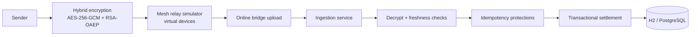

# MeshRelay — Encrypted Offline-Payment Relay Prototype


MeshRelay is a **local, educational Spring Boot prototype** that simulates how an encrypted payment instruction can move across disconnected devices and settle only when a relay regains internet access.

> [!IMPORTANT]
> This is a simulation, **not** a real banking/UPI integration. It does not connect to NPCI or move real money.

**Quick links:** [Overview](#overview) · [How it works](#how-it-works) · [Quick start](#quick-start) · [API & demo usage](#api--demo-usage) · [Architecture](#architecture) · [Limitations](#limitations)

---

## Table of contents

- [Overview](#overview)
- [How it works](#how-it-works)
- [Architecture](#architecture)
- [Prerequisites](#prerequisites)
- [Quick start](#quick-start)
- [Run with PostgreSQL (optional)](#run-with-postgresql-optional)
- [API & demo usage](#api--demo-usage)
- [Configuration](#configuration)
- [Project structure](#project-structure)
- [Testing](#testing)
- [Limitations](#limitations)
- [Contributing](#contributing)

---

## Overview

MeshRelay demonstrates a **store-carry-forward** relay model for offline-style payment delivery:

- Sender-side payment instruction is encrypted with a hybrid scheme.
- Encrypted packet is carried by simulated mesh devices.
- Any internet-enabled bridge uploads packets to the backend.
- Backend validates, de-duplicates, and applies a simulated ledger outcome.

---

## How it works

### Relay-network diagram (provided)


The diagram represents this flow in the prototype:

1. **Sender** creates a payment instruction.
2. Instruction is encrypted and propagated through the **relay network** (virtual devices).
3. A connected bridge forwards it to the **bank server** role (the Spring Boot backend in this repo).
4. Backend validates/decrypts and records a simulated outcome for the **receiver**.

This is exactly the project’s encrypted offline-payment simulation: delayed delivery first, settlement only at backend receipt time.

<details>
<summary><strong>Step-by-step simulation flow</strong></summary>

1. `POST /api/demo/send` creates an encrypted packet and injects it into a start device.
2. `POST /api/mesh/gossip` relays packets between virtual devices while TTL decreases.
3. `POST /api/mesh/flush` simulates online bridge nodes concurrently uploading held packets.
4. `POST /api/bridge/ingest` decrypts, validates freshness/idempotency, and settles or rejects.
5. `GET /api/accounts` and `GET /api/transactions` show the simulated ledger state.

</details>

---

## Architecture



For component boundaries and invariants, see [`/docs/ARCHITECTURE.md`](docs/ARCHITECTURE.md).

---

## Prerequisites

- JDK 17+
- Internet on first run (Maven Wrapper downloads dependencies)

---

## Quick start

### 1) Run locally (H2 default)

**macOS/Linux**
```bash
chmod +x mvnw
./mvnw spring-boot:run
```

**Windows PowerShell**
```powershell
.\mvnw.cmd spring-boot:run
```

Then open:

- Dashboard: http://localhost:8080
- H2 console (local only): http://localhost:8080/h2-console

<details>
<summary><strong>Default H2 connection values</strong></summary>

- JDBC URL: `jdbc:h2:mem:meshrelay;DB_CLOSE_DELAY=-1;DB_CLOSE_ON_EXIT=FALSE`
- Username: `sa`
- Password: *(blank)*

</details>

### 2) Try the demo quickly

```bash
curl -X POST http://localhost:8080/api/demo/send \
  -H "Content-Type: application/json" \
  -d '{
    "senderVpa": "alice@mesh",
    "receiverVpa": "bob@mesh",
    "amount": 25.50,
    "demoToken": "demo-only",
    "ttl": 5,
    "startDevice": "phone-1"
  }'
```

Then run:

1. `POST /api/mesh/gossip` a few times
2. `POST /api/mesh/flush`
3. Check `GET /api/accounts` and `GET /api/transactions`

---

## Run with PostgreSQL (optional)

```bash
docker compose up --build
```

Or run app only with a local PostgreSQL instance:

```powershell
$env:SPRING_PROFILES_ACTIVE = "postgres"
$env:DB_URL = "jdbc:postgresql://localhost:5432/meshrelay"
$env:DB_USERNAME = "meshrelay"
$env:DB_PASSWORD = "<your-local-password>"
.\mvnw.cmd spring-boot:run
```

---

## API & demo usage

> [!WARNING]
> Endpoints are intentionally open for local demonstration and should not be exposed publicly.

### Core endpoints

| Method | Endpoint | Purpose |
|---|---|---|
| GET | `/api/server-key` | Demo server public key + crypto metadata |
| POST | `/api/demo/send` | Create encrypted packet and inject into mesh |
| GET | `/api/mesh/state` | Mesh device state and packet counts |
| POST | `/api/mesh/gossip` | Run one relay round |
| POST | `/api/mesh/flush` | Upload held packets from online bridge nodes |
| POST | `/api/mesh/reset` | Clear mesh queues and in-memory idempotency cache |
| POST | `/api/bridge/ingest` | Ingest one bridge-delivered packet |
| GET | `/api/accounts` | List simulated balances |
| GET | `/api/transactions` | List latest simulated outcomes |
| GET | `/actuator/health` | Health endpoint |

<details>
<summary><strong>Additional auth & connectivity endpoints</strong></summary>

| Method | Endpoint | Purpose |
|---|---|---|
| POST | `/api/auth/register` | Create demo user + start session |
| POST | `/api/auth/login` | Start session with username/email + password |
| GET | `/api/auth/me` | Return current session profile |
| POST | `/api/auth/logout` | End current session |
| POST | `/api/mesh/connectivity` | Set total online devices (0–5) |
| POST | `/api/mesh/devices/{deviceId}/connectivity` | Set one device online/offline |

</details>

---

## Configuration

Key runtime properties (see `src/main/resources/application.properties` and `application-postgres.properties`):

| Property | Purpose |
|---|---|
| `SERVER_PORT` | HTTP port (default `8080`) |
| `DB_URL`, `DB_USERNAME`, `DB_PASSWORD`, `DB_DRIVER` | Datasource settings |
| `DDL_AUTO` | Hibernate schema mode (default `update`) |
| `H2_CONSOLE_ENABLED` | Enables H2 console in default profile |
| `upi.mesh.idempotency-ttl-seconds` | In-memory duplicate-claim TTL |
| `upi.mesh.packet-max-age-seconds` | Packet freshness window |
| `upi.mesh.clock-skew-seconds` | Allowed timestamp skew |

---

## Project structure

```text
src/main/java/io/meshrelay/prototype/
├── config/       # config beans/properties
├── controller/   # REST endpoints + dashboard route + API error handling
├── crypto/       # hybrid encryption and demo server key handling
├── model/        # entities and repositories
└── service/      # mesh simulation, ingestion, idempotency, settlement
src/main/resources/
├── application.properties
├── application-postgres.properties
└── templates/dashboard.html
src/test/java/io/meshrelay/prototype/
├── IdempotencyConcurrencyTest.java
└── service/PasswordHashServiceTest.java
docs/ARCHITECTURE.md
```

---

## Testing

```bash
./mvnw test
```

(Windows: `.\mvnw.cmd test`)

Current tests cover concurrency/idempotency behavior, simulated balance safety, tamper rejection, encryption/decryption round-trip, and password hashing behavior.

---

## Limitations

- No real UPI/NPCI/bank integration (simulated ledger only)
- No BLE transport (in-memory virtual mesh only)
- No sender signatures or enrolled device identity
- Process-local idempotency cache (DB uniqueness is additional defense)
- Demo keypair is regenerated on startup
- No production authn/authz hardening for bridge/API

---

## Contributing

1. Fork and create a focused feature branch.
2. Keep changes small and scoped.
3. Run tests before opening a PR.
4. Preserve the prototype-scope safety notes.

If you are proposing protocol/security changes, include rationale and threat-model impact.
