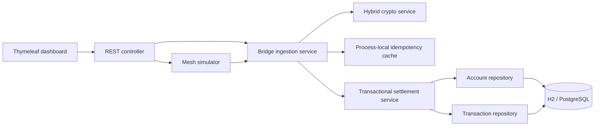
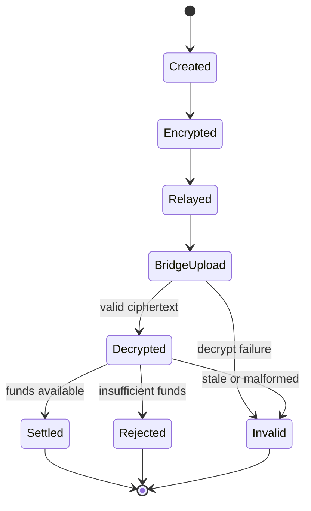

# MeshRelay Architecture Notes

## Scope

MeshRelay is a demonstrator for delayed delivery of encrypted instructions. It is not a banking product. The architecture is deliberately a modular monolith so the core concepts are easy to run and inspect locally without adding unnecessary infrastructure.

## Runtime components

## Responsibilities and boundaries

- `controller`: HTTP contract, request validation, and API error response formatting.
- `service`: business orchestration, packet relay simulation, idempotency, and ledger settlement.
- `crypto`: RSA-OAEP key wrapping, AES-GCM payload encryption/decryption, and ciphertext fingerprinting.
- `model`: JPA entities, the encrypted packet wire model, payment instruction, and Spring Data repositories.
- Database schema creation and updates are handled by Hibernate's configured `ddl-auto` mode.

Core components use constructor injection. Controllers do not contain ledger mutation logic; settlement remains in a single transactional service.

## Settlement invariants

1. The sender and receiver must be distinct existing accounts.
2. Amount must be positive and have at most two fractional digits.
3. Sender and receiver rows are selected under pessimistic write locks in VPA order.
4. Insufficient balance creates a `REJECTED` outcome and does not change balances.
5. A successful debit, credit, and transaction record are part of one database transaction.
6. The database uniquely constrains the packet hash so the same ciphertext cannot produce multiple ledger records.
7. The process-local cache suppresses concurrent duplicate ingestion within one running instance, but is not the source of durable idempotency.

## Packet lifecycle

The packet lifecycle shown above is a conceptual flow. The in-memory cache does not persist all intermediate states. Durable receipt-state recovery is a known future enhancement.

## Security threat notes

| Threat | Current mitigation | Remaining gap |
|---|---|---|
| Ciphertext modified in transit | AES-GCM authentication tag | No sender identity is proven by encryption alone |
| Same packet uploaded concurrently | Atomic process-local claim and unique ledger hash | Cache is not shared between app instances |
| Old packet replay | Signed timestamp freshness window | Timestamp is not a cryptographic signature |
| Concurrent spending of same balance | Database row locks and transaction boundaries | Cannot prevent conflicting offline instructions before server receipt |
| Unauthorized bridge upload | None in the local prototype | Add bridge identity, authentication, and authorization before shared deployment |
| Server key compromise/restart | Ephemeral keypair generated at startup | Use managed keys and rotation policy in a real design |
| Secret exposure | Demo-only token; no real credential required | Do not deploy the open demo endpoints publicly |

## Why no microservices, Kafka, or Redis yet?

The current scale and learning goal do not justify distributed infrastructure. The most important correctness properties can be tested with one Spring Boot process and a relational database. A persistent idempotency store, message broker, or separate services should be introduced only when a specific durability, throughput, or deployment requirement calls for it.

## Verification matrix

| Scenario | Expected result |
|---|---|
| Encrypt then decrypt a valid instruction | Original fields preserved |
| Tamper with encrypted payload | `INVALID`; no balance changes |
| Upload the same ciphertext concurrently | One settlement; remaining requests are duplicates |
| Two distinct transfers compete for the same funds | At most one succeeds if the balance only covers one |
| Insufficient balance | `REJECTED`; balances unchanged |
| Stale packet | `INVALID` with `stale_packet` reason |
| Malformed request DTO | HTTP 400 with a structured validation error |

## Before any shared or public deployment

Add sender digital signatures and key enrollment, authenticated bridge nodes, API authorization, rate limits, request size limits at the edge, managed key storage, persistent receipt states, security tests, and operational monitoring. A real offline payment protocol additionally needs a credible double-spend/settlement model and external financial-institution approval; those are outside this prototype.
